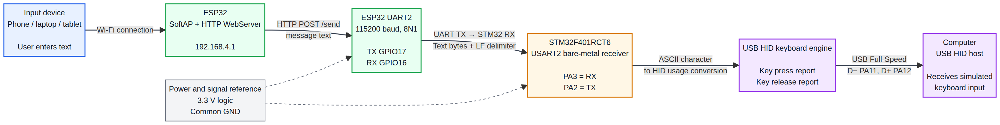
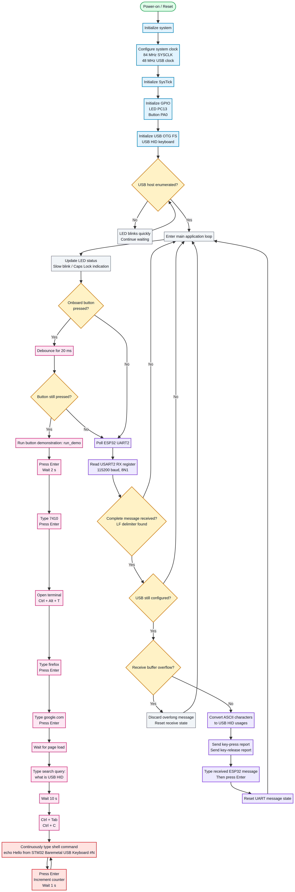

# STM32F401RCT6 + ESP32 Wi-Fi USB HID Keyboard

A bare-metal embedded-systems project in which an STM32F401RCT6 appears to a computer as a USB HID keyboard. The STM32 can receive text from an ESP32 Wi-Fi web interface, or run a built-in keyboard demonstration when its onboard button is pressed.

> **Safety and authorization:** This firmware generates simulated keyboard input and includes commands that open a terminal and launch a browser. Use it only on computers where you have explicit permission. Test first with a harmless text editor and remove or change the demonstration commands before using it on another system.

## 1. What the project does

There are two operating modes.

### Mode A — ESP32 web input

1. A phone or laptop connects to the ESP32 access point.
2. The user opens the ESP32 web page.
3. The user enters text and presses **Send**.
4. The ESP32 sends the text over UART2 to the STM32.
5. The STM32 waits for the line-feed delimiter (`LF`, `0x0A`).
6. The STM32 converts supported ASCII characters into USB HID keyboard reports.
7. The computer connected to the STM32 receives the text as keyboard input.

### Mode B — onboard-button demonstration

1. The STM32 USB HID device enumerates.
2. The user presses the onboard button on PA0.
3. The STM32 debounces the button for 20 ms.
4. The built-in `run_demo()` function executes the predefined HID sequence.
5. `run_demo()` eventually enters an intentional infinite loop that types incrementing shell commands.

**Button priority:** If the button is pressed, the button mode takes priority. Because `run_demo()` contains an infinite loop, the ESP32 mode does not resume until the STM32 is reset.

## 2. Repository structure

```text
firmware/stm32/main.c                 Combined bare-metal STM32 application
firmware/esp32/esp32_web_uart.ino     ESP32 web server and UART firmware
docs/block-diagram.png                Rendered system block diagram
docs/block-diagram.mmd                Editable block diagram
docs/flowchart.png                   Rendered program flowchart
docs/flowchart.mmd                   Editable flowchart
docs/cubemx-setup.md                 Pin/clock planning notes
docs/protocol.md                     UART protocol
docs/flashing-guide.md               Build and test instructions
docs/project-files-note.md           Missing-project-files warning
hardware/wiring.md                   Hardware list, photos, and wiring
hardware/*.jpg                      Product-linked hardware photos
```

## 3. Hardware required

- STM32F401RCT6 development board, typically a Black Pill-style board.
- ESP32 development board with exposed GPIO16 and GPIO17.
- ST-LINK/V2 or another compatible STM32 programmer/debugger.
- USB cable for the STM32 USB device connection.
- USB cable for programming/powering the ESP32, if required by the board.
- Three jumper wires for UART TX, UART RX, and common ground.
- Computer with a USB port and a text editor for testing.
- Phone or laptop to connect to the ESP32 Wi-Fi access point.

See [`hardware/wiring.md`](hardware/wiring.md) for the exact product labels and links, photographs, pin mapping, and warnings.

## 4. Pin connections

### ESP32 to STM32 UART

| ESP32 | STM32F401RCT6 |
|---|---|
| GPIO17 / UART2 TX | PA3 / USART2_RX |
| GPIO16 / UART2 RX | PA2 / USART2_TX |
| GND | GND |

The UART lines must be crossed:

```text
ESP32 TX GPIO17 → STM32 RX PA3
ESP32 RX GPIO16 ← STM32 TX PA2
ESP32 GND       → STM32 GND
```

Both boards must use 3.3 V logic. Never connect a 5 V UART signal directly to the STM32 pins.

### STM32 pins used by the application

| STM32 pin | Function |
|---|---|
| PA0 | Onboard programmable button |
| PA2 | USART2_TX |
| PA3 | USART2_RX |
| PA11 | USB OTG FS D− |
| PA12 | USB OTG FS D+ |
| PC13 | Status LED on the assumed board, if present |

## 5. Communication protocol

The ESP32 uses HTTP locally and UART between boards:

```text
Phone/laptop → Wi-Fi HTTP POST → ESP32 → UART2 → STM32 → USB HID → computer
```

UART settings:

```text
Baud rate: 115200
Format: 8 data bits, no parity, 1 stop bit (8N1)
Flow control: None
Message terminator: LF, 0x0A
Effective message limit: 120 characters from the supplied web form
```

Example UART frame:

```text
Hello STM32\n
```

The STM32 ignores carriage return and uses LF as the end-of-message delimiter. The basic implementation has no acknowledgement, checksum, retransmission, authentication, or message queue.

## 6. STM32 source

`firmware/stm32/main.c` is the combined source. It contains:

- Clock and SysTick setup.
- GPIO setup for the LED and onboard button.
- Direct-register USART2 setup.
- Polled UART reception.
- USB OTG FS device initialization.
- HID keyboard descriptors and report handling.
- ASCII-to-HID conversion.
- Button debounce and `run_demo()`.
- ESP32 message processing.
- LED status indication.

The source is written as a register-level bare-metal application. It is **not** a complete standalone repository by itself: it still needs a valid Cortex-M4 startup file, linker script, vector table, and device/build support files from an STM32 project.

## 7. Is the repository sufficient for a random person to build everything?

**Not completely as currently supplied.** A visitor with the hardware can understand and reproduce the design, flash the ESP32 sketch, and use the STM32 application source, but the ZIP does not contain the original STM32 startup assembly, linker script, CMSIS/device support files, CubeIDE metadata, or CubeMX `.ioc` project file.

To make the project fully buildable by a new visitor, add the following files from the original STM32CubeIDE/bare-metal project that successfully built the USB HID firmware:

```text
startup_stm32f401xx.s
STM32F401RCTx_FLASH.ld
system_stm32f4xx.c, if used by the original project
CMSIS/device headers, if used by the original project
vector-table/startup support
project build files or a Makefile/CMake configuration
```

The warning and required-file list are also recorded in [`docs/project-files-note.md`](docs/project-files-note.md).

## 8. Is the CubeMX guide needed?

The CubeMX guide is **not needed to understand the runtime code** because `main.c` directly configures the clock, GPIO, USART2, and USB registers.

It is still useful for:

- Verifying the selected MCU.
- Checking PA2/PA3 alternate functions.
- Checking PA11/PA12 USB pins.
- Reproducing the clock plan.
- Documenting the design for a report.
- Creating a new project shell if the original startup/linker files are unavailable.

Do not mix CubeMX-generated HAL UART initialization with this bare-metal source. In particular, do not add `MX_USART2_UART_Init()`, `HAL_UART_Receive()`, or `HAL_UART_Receive_IT()` unless you deliberately convert the entire project to a HAL implementation.

## 9. ESP32 setup

1. Open `firmware/esp32/esp32_web_uart.ino` in Arduino IDE.
2. Install the ESP32 board package.
3. Select the correct ESP32 board and serial port.
4. Replace `CHANGE_THIS_PASSWORD` with a private Wi-Fi password of at least eight characters.
5. Flash the sketch.
6. Open Serial Monitor at 115200 baud.
7. Connect a phone or laptop to the `STM32_ESP32` network.
8. Open the IP address printed by the ESP32, normally `http://192.168.4.1`.
9. Submit a short message through the web form.

## 10. STM32 build and flash

1. Obtain the startup, linker, vector, and device support files from the original STM32 project.
2. Build `firmware/stm32/main.c` for an STM32F401RCT6 / Cortex-M4 target.
3. Verify the actual external crystal frequency. The source currently assumes `HSE_MHZ = 25`.
4. Verify the clock plan: 84 MHz SYSCLK, 42 MHz APB1, and 48 MHz USB clock.
5. Program the board with ST-LINK.
6. Connect the STM32 USB port to the computer.
7. Open a text editor before testing.
8. Test the ESP32 path without pressing the STM32 button.
9. Reset the STM32 before testing the button demonstration again.

See [`docs/flashing-guide.md`](docs/flashing-guide.md) and [`docs/cubemx-setup.md`](docs/cubemx-setup.md).

## 11. Troubleshooting

- **USB keyboard not detected:** check PA11/PA12, USB clock accuracy, USB cable, vector table, and startup files.
- **No ESP32 text:** check crossed TX/RX, common ground, 115200 8N1, PA2/PA3, and the LF delimiter.
- **Garbled text:** check that APB1 is 42 MHz and that the external crystal setting matches the board.
- **Web page unavailable:** connect the phone/laptop to the ESP32 access point and use the IP printed in Serial Monitor.
- **ESP32 stops working after button press:** expected; `run_demo()` intentionally never returns. Reset the STM32.
- **Some characters do not type:** only the characters handled by `ascii_to_hid()` are supported.

## 12. Project diagrams




