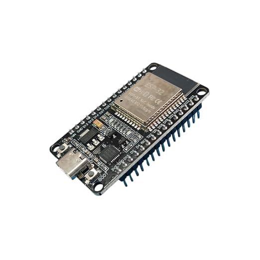
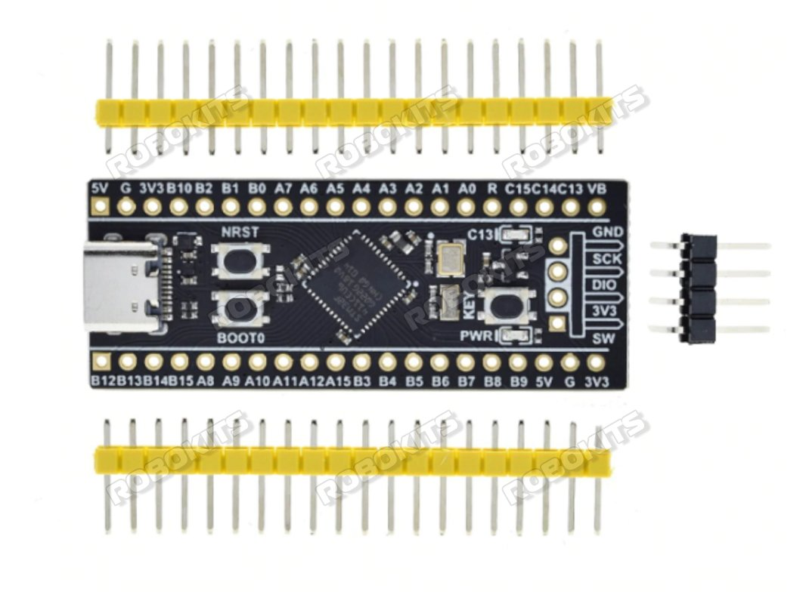
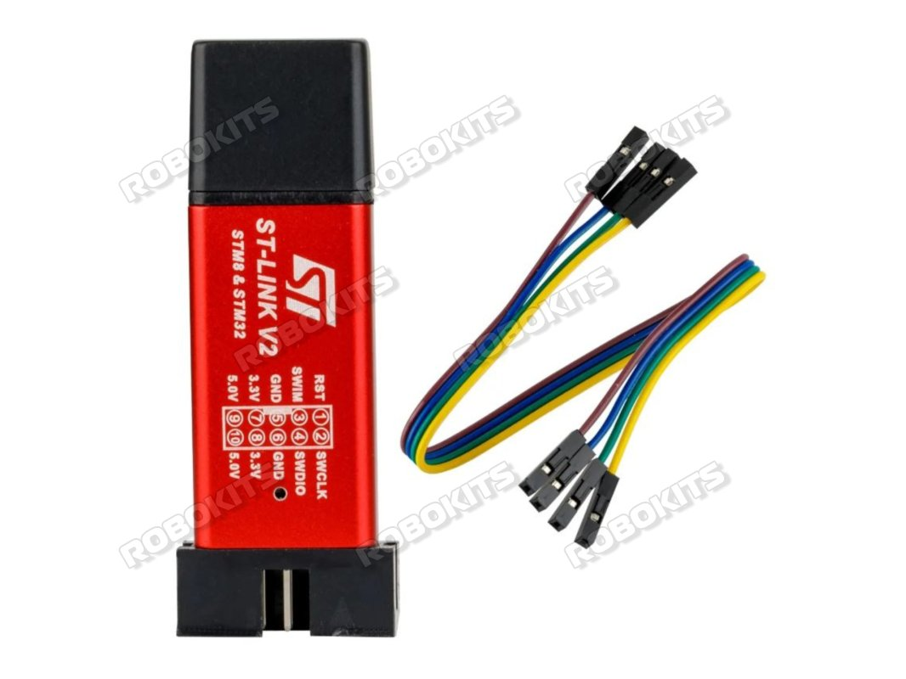

# Hardware Used, Product Links, Photos, and Wiring

The product links and photographs below correspond to the hardware listings supplied for this project. Product availability, appearance, and revisions may change; verify the pin labels on the physical boards before powering them.

## 1. ESP32 development board

**Product:** SP ELECTRON ESP32 Development Board DevKit V1 30-Pin with ESP32-WROOM-32, Dual-Core 240 MHz, Wi-Fi and Bluetooth 4.2, 4 MB Flash, Micro USB, 3.3 V.

**Product page:** [Amazon India — SP ELECTRON ESP32 Development Board DevKit V1 30-Pin](https://www.amazon.in/SP-ELECTRON-ESP32-Development-ESP32-WROOM-32/dp/B0HD7QC26L)



Role in this project:

- Creates the `STM32_ESP32` Wi-Fi access point.
- Hosts the HTTP web page.
- Receives text from a phone or laptop.
- Sends text to the STM32 using UART2.

UART pins used:

| ESP32 pin | Function |
|---|---|
| GPIO16 | UART2 RX |
| GPIO17 | UART2 TX |
| GND | Common electrical reference |

## 2. STM32 development board

**Product:** STM32F401RCT6 STM32 ARM Core Board Development Board.

**Product page:** [Robokits — STM32F401RCT6 STM32 ARM Core Board Development Board](https://robokits.co.in/development-board/motor-control-boards/arm-development-board/stm32f401rct6-stm32-arm-core-board-development-board)



Role in this project:

- Runs the bare-metal USB HID firmware.
- Reads the onboard programmable button on PA0.
- Receives text through USART2.
- Presents itself to the computer as a USB keyboard.

Important pins:

| STM32 pin | Function in this project |
|---|---|
| PA0 | Onboard programmable button |
| PA2 | USART2_TX |
| PA3 | USART2_RX |
| PA11 | USB OTG FS D− |
| PA12 | USB OTG FS D+ |
| PC13 | Status LED, if present on the board |
| GND | Common electrical reference |

> **Board verification:** The firmware assumes the onboard button is connected to PA0 and is active-low. Confirm this on the exact STM32F401RCT6 board revision before flashing.

## 3. STM32 programmer/debugger

**Product:** ST-LINK V2 for STM8 and STM32 Programmer Clone.

**Product page:** [Robokits — ST-LINK V2 for STM8 and STM32 Programmer Clone](https://robokits.co.in/programmers/stm32-stm08/st-link-v2-for-stm8-and-stm32-programmer-clone)



Role in this project:

- Programs the STM32 firmware.
- Provides SWD debugging access when connected to the STM32 board.

The exact SWD connections depend on the board header. Match the labels on the programmer and target board:

```text
ST-LINK SWDIO → STM32 SWDIO
ST-LINK SWCLK → STM32 SWCLK
ST-LINK GND   → STM32 GND
```

Use the board's 3.3 V reference as required by the programmer documentation. Do not apply an unknown external voltage to the STM32.

## 4. Other required items

- USB data cable for the STM32 USB device connection to the host computer.
- USB data/power cable for programming or powering the ESP32.
- Three 3.3 V-compatible jumper wires for TX, RX, and GND.
- Computer with a USB port and a text editor for testing.
- Phone or laptop to connect to the ESP32 access point.

## 5. ESP32-to-STM32 UART wiring

| ESP32 | STM32F401RCT6 |
|---|---|
| GPIO17 / UART2 TX | PA3 / USART2_RX |
| GPIO16 / UART2 RX | PA2 / USART2_TX |
| GND | GND |

The UART lines must be crossed:

```text
ESP32 TX GPIO17 → STM32 RX PA3
ESP32 RX GPIO16 ← STM32 TX PA2
ESP32 GND       → STM32 GND
```

Both boards must use 3.3 V logic. Never connect a 5 V UART signal directly to STM32 PA2 or PA3.

## 6. STM32 USB and button connections

| STM32 pin | Function |
|---|---|
| PA0 | Onboard programmable button |
| PA11 | USB OTG FS D− |
| PA12 | USB OTG FS D+ |
| PC13 | Onboard LED, if present |

Connect the STM32 USB port to the computer that should receive the simulated keyboard input.

## 7. Image and product-source note

The local image files are copies of product images associated with the supplied listings and are included for project documentation and identification. The product pages remain the authoritative source for the exact seller listing, specifications, availability, and licensing terms.
